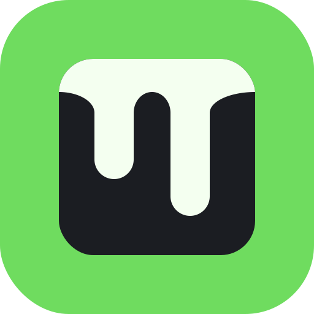

  

<h1 align="center">🫠 goome 🫠</h1>

<b>See-through, always on top overlays for any program. Draw on top of everything and only what you draw takes clicks. Hotkeys and screen grabs too, plus a built in UI kit.</b>

   
  a notes app, a stream overlay and a mod menu, all goome, running on my GNOME desktop

  
  
  
  
  
  
  
  

  goome puts a see-through layer on top of every app on your screen. You draw on it, only the parts you draw take clicks, and everything else goes right through to whatever is under it. Good for game overlays and little HUDs.   
  You can make apps and overlays with it, or game mods and UI inside an engine, all from the same code.   
  It's a single C header you drop in and it runs on Linux (X11 and Wayland), Windows and macOS. There are C# and Python bindings, Java and Godot ones too, and it works in Unity and Minecraft mods.   
  The <a href="https://goome-ui.github.io/docs/">docs</a> have everything, and the <a href="https://goome-ui.github.io/docs/builder/">UI builder</a> lets you drag a layout together in your browser and gives you the code. 
  <a href="https://github.com/goome-ui/examples">Examples</a> are up too if you want to jump in.   
  To try it first, grab one of the <a href="https://goome-ui.github.io/docs/downloads/">ready made apps</a> from the <a href="https://github.com/goome-ui/examples/releases/latest">examples release</a>. To start your own, <code>goome new</code> from <a href="https://github.com/goome-ui/goome-cli">goome-cli</a> makes a project from a template in any of the languages.   
  Anyone can help out. A desktop it doesnt work on yet is the best thing you can send, read the <a href="https://github.com/goome-ui/.github/blob/main/CONTRIBUTING.md">contributing guide</a> first. Questions go in <a href="https://github.com/goome-ui/c-goome/discussions">Discussions</a>, and every main repo has a few <a href="https://goome-ui.github.io/docs/community/">good first issues</a>.   
  Do you like this project? If so, please let me know!
  <a href="https://sevvy-wevvy.com/discord">Discord</a>

<h3 align="center">📦 Repos 📦</h3>

| Repo | What it is |
| :---: | :---: |
| <a href="https://github.com/goome-ui/c-goome"><b>c-goome</b></a> | The main one, the C library. Just drop in <code>goome.h</code> |
| <a href="https://github.com/goome-ui/csharp-goome"><b>csharp-goome</b></a> | C# bindings for .NET 8, with a Unity package and Unity mod templates |
| <a href="https://github.com/goome-ui/python-goome"><b>python-goome</b></a> | Python bindings over ctypes, nothing to build |
| <a href="https://github.com/goome-ui/java-goome"><b>java-goome</b></a> | Java 22+ bindings (FFM or LWJGL), plus Fabric and NeoForge mods |
| <a href="https://github.com/goome-ui/godot-goome"><b>godot-goome</b></a> | A GDExtension so you can use it in Godot |
| <a href="https://github.com/goome-ui/docs"><b>docs</b></a> | The <a href="https://goome-ui.github.io/docs/">docs site</a> and the <a href="https://goome-ui.github.io/docs/builder/">UI builder</a> |
| <a href="https://github.com/goome-ui/examples"><b>examples</b></a> | Small apps and overlays you can copy from, mods and engine demos. The <a href="https://github.com/goome-ui/examples/releases/latest">apps to download</a> are on its releases |
| <a href="https://github.com/goome-ui/goome-cli"><b>goome-cli</b></a> | <code>goome new</code>, makes you a new project from a template |
| <a href="https://github.com/goome-ui/vscode-goome"><b>vscode-goome</b></a> | VS Code extension with snippets, hover docs, new project and a builder preview |
| <a href="https://goome-ui.github.io/docs/templates/"><b>goome-app-template-*</b></a> | A tiny ready app to start from in <a href="https://github.com/goome-ui/goome-app-template-c">C</a>, <a href="https://github.com/goome-ui/goome-app-template-csharp">C#</a>, <a href="https://github.com/goome-ui/goome-app-template-python">Python</a>, <a href="https://github.com/goome-ui/goome-app-template-java">Java</a> or <a href="https://github.com/goome-ui/goome-app-template-godot">Godot</a> |
| <a href="https://github.com/goome-ui/awesome-goome"><b>awesome-goome</b></a> | A list of everything made with goome, apps, mods, guides and tools. Add yours with a PR |

<h3 align="center">🫶 Contributors 🫶</h3>

Thanks to everyone who helps out across all the goome repos, every fix, issue and PR counts!   

